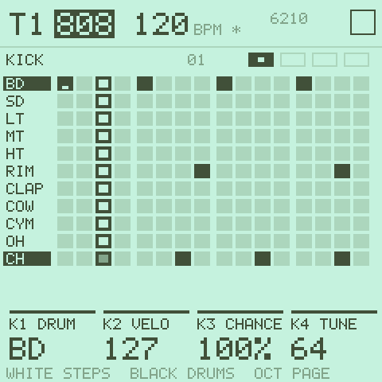

<div align="center">

# 6210 Drum Peter

**An 808 + 909 + 303 drum machine firmware for the M-VAVE FM-1, with TR-style step keys and button lights that blink with a purpose.**

[](https://github.com/orion-musica/6210-FM-1/actions/workflows/build.yml)


[**Website & web installer**](https://orion-musica.github.io/6210-FM-1/) ·
[Manual](https://orion-musica.github.io/6210-FM-1/manual/) ·
[Install](#installation) ·
[Quick start](#quick-start) ·
[Build](#building-from-source) ·
[License](#license)



</div>

---

> [!WARNING]
> **6210 is a beta.** It builds cleanly and passes host tests that run its real screen code, but it has
> not been tested on many physical FM-1s yet. Back up your projects, voices and samples before installing.
> The web installer can always put the original V15 firmware back.

## Contents

- [What it is](#what-it-is)
- [Features](#features)
- [Installation](#installation)
- [Quick start](#quick-start)
- [Controls](#controls)
- [Blink codes](#blink-codes)
- [Limits](#limits)
- [Building from source](#building-from-source)
- [Repository layout](#repository-layout)
- [Credits](#credits)
- [License](#license)

## What it is

One drum machine, one job: special tasks for my brother. 6210 is a fork of
[3310](https://github.com/orion-musica/3310_FM-1), itself built on M-VAVE's official
[FM1 Open V14](https://github.com/m-vave/fm1_open). It keeps the two-tone phone-style screen of 3310
and replaces its ARRANGE page with a classic drum machine page: one row per drum, sixteen steps, the
white keys as step buttons and the black keys as drum pads.

The sequencer and the sound engines are M-VAVE's FM1 Open library, so timing stays sample accurate.
6210 changes the app layer only: the DRUM page, the LED logic, the start screen and the kit setup.

## Features

| | |
|---|---|
| **808 kit** | Track 1: eleven drums on the DRUM 808 engine (BD, SD, LT, MT, HT, RIM, CLAP, COW, CYM, OH, CH). |
| **909 style kit** | Track 2: the same engine voiced shorter, brighter and harder. |
| **303 acid** | Track 3: the BASS 303 engine with a starter acid line. |
| **TR step keys** | 16 white keys = 16 steps of the selected drum; black keys pick and play drums. |
| **Velocity and chance** | Per step, on K2 and K3. Accent from velocity 120. |
| **Up to 64 steps** | 16 / 32 / 48 / 64 steps per track, paged with OCT − / +. |
| **Roll** | The FM1 Open drum repeat on ARP. |
| **Blink codes** | Every panel light has a rhythm that tells you the machine's state. |
| **Auto kit** | An empty project becomes the 6210 kit on start; EDIT + SAVE loads it any time. |
| **Everything else** | The step editor, sound editors, FX, mixer, projects, MIDI and arpeggiator of FM1 Open stay. |

## Installation

1. **Back up.** Export the projects, voices and samples you want to keep.
2. **Open the installer** at <https://orion-musica.github.io/6210-FM-1/install/> in desktop **Chrome or Edge**.
3. **Connect** the FM-1 with a USB data cable, press **START INSTALLER**, then **Connect device**, and allow MIDI / SysEx.
4. **From stock V15** the first time: click **Enable force flash and reconnect**.
5. **Install** and keep the FM-1 connected until the installer says it is done.

The firmware file is also attached to every [release](https://github.com/orion-musica/6210-FM-1/releases)
as `6210.fwsc`, with its SHA-256. To go back, open the installer and choose **Restore original V15**.

## Quick start

1. Switch on. After the start screen the **DRUM** page opens. On an empty project the 6210 kit is loaded
   (`6210 KIT READY`).
2. Press **PLAY**.
3. Press a **black key** to pick a drum (first black key = kick, then snare, toms, rim, clap, cowbell,
   cymbal, open hat, closed hat).
4. Press **white keys** to set and clear that drum's steps.
5. Turn **K2** for the velocity of the step you touched last, **K3** for its chance, **K4** to tune the drum.
6. Turn **SELECT** for tracks 2 (909 style) and 3 (303).
7. Press **SAVE** to keep it.

The [manual](https://orion-musica.github.io/6210-FM-1/manual/) explains every control and page.

## Controls

On the DRUM page:

| Control | Action |
|---|---|
| `SELECT` | Track 1–8 |
| `ALGORITHM` | Track length 16 / 32 / 48 / 64 |
| `PRESETS` | Kit / program of the track |
| `K1` | Drum (drum tracks) or note (melodic tracks) |
| `K2` | Velocity of the edited step |
| `K3` | Chance of the edited step (12–100 %) |
| `K4` | Drum tune · 303 cutoff · DX7 volume |
| White keys | Steps 1–16 of the page |
| Black keys | Pick and play a drum (melodic tracks: play notes) |
| `OCT −` / `OCT +` | Previous / next 16 steps |
| `EDIT` tap / hold | Sound editor / kit menu (`SAVE` = load the 6210 kit, `PRESETS` = engine) |
| `SEQ` | Full step editor (swing, click, count-in, MIDI clock, locks) |
| `HOME` | Project and preset browser |
| `GLO` | Mixer (keys 1–8 mute, 9–16 solo, K1–K4 volumes) |
| `ARP` | Roll on / off; hold for its settings |
| `HOME` + `SEQ` | Tap tempo |
| `HOME` + `SAVE` | Undo / redo |
| `HOME` + `PLAY` | Stop everything |

## Blink codes

The FM-1's lights are on or off, so every state has a rhythm instead of a brightness.

| Light | Rhythm | Means |
|---|---|---|
| White key | steady | the selected drum plays on this step |
| White key | running light | playhead: an empty step lights briefly, a set step blinks off |
| White key | 2 Hz while stopped | the step you are editing |
| Black key | steady / short flash | selected drum / that drum just played |
| `PLAY` | first third of each beat, longer on beat 1 | playing (slow blink: paused) |
| `REC` | 8 Hz | recording |
| `SAVE` | 1 Hz | unsaved edits |
| `GLO` | double flash every bar | a track is muted or soloed |
| `ARP` | every sixteenth | roll on |
| `OCT −` / `+` | steady | more steps that way |

## Limits

- **Engine.** The sequencer and sound engines are the closed FM1 Open V14 library: eight tracks, loops of
  16, 32, 48 or 64 steps, velocity and chance per step (velocity is shared by all drums on a step).
- **909.** There is no separate 909 engine. Track 2 is the 808 engine with 909-style settings.
- **Lights.** No dimming on the panel, hence the blink codes.
- **Flash.** The application has to fit in 453,921 bytes. 0.1 BETA uses 452,968.
- **Ideas not in 0.1** (from the design): ghost notes, hypno drift, dark-club VU on the keys, stutter.
  They need more flash space than is left.

## Building from source

### In the cloud (recommended)

Every push to `main` runs [`.github/workflows/build.yml`](.github/workflows/build.yml):

1. **host-test** (Linux): compiles the real app and screen code with the browser engine, plays the
   panel scripts in `tools/host/tests` and keeps the screenshots as an artifact.
2. **build** (Windows): installs the JieLi toolchain 2.5.3, builds the firmware, the web installer and the
   site, and uploads them as the `6210` artifact.
3. **pages**: publishes `docs/` to GitHub Pages (public repository, Pages source set to *GitHub Actions*).
4. **release**: on a tag such as `v0.1.0-beta`, publishes a GitHub Release with `6210.fwsc`.

### On Windows

Requires PowerShell, `curl.exe`, `tar.exe` and the
[JieLi Windows toolchain 2.5.3](https://jl-update.oss-cn-shenzhen.aliyuncs.com/2.5.3.exe).
Double-click `INSTALL-6210.bat`: it finds the toolchain, builds everything and opens the installer on
`http://localhost:8766`. By hand:

```powershell
$env:FM1_PI32_TOOLCHAIN = 'C:\JL\pi32'
$env:FM1_SOURCE_URL = 'https://github.com/orion-musica/6210-FM-1/archive/refs/heads/main.zip'
.\tools\Make-Site.ps1        # firmware + installer + site in docs\
.\tools\Build-Web.ps1 -LocalPreview   # browser preview only
```

### Host test (Linux or macOS)

Needs `clang` (or `gcc` with `CC=gcc`) and Python 3 with Pillow for the pictures:

```sh
sh tools/host/build.sh
```

Screenshots land in `build/host/<test>/*.png`, each with the 41 panel LEDs drawn under the screen.
Test scripts are plain text; see the commands at the top of [`tools/host/harness.c`](tools/host/harness.c).

## Repository layout

| Path | Contents |
|---|---|
| `app/drum.inc` | **6210:** DRUM page, keyboard, kit setup |
| `app/screen.c` | Screen and panel code (6210 LED blink codes, start screen, hooks) |
| `app/`, `web/`, `third_party/` | FM1 Open application and browser engine sources |
| `sdk/` | FM1 Open SDK: binary engine, build and packaging scripts |
| `tools/host/` | **6210:** native host test harness and scripts |
| `tools/Make-Site.ps1`, `tools/ci/` | Site build and cloud toolchain setup |
| `docs/` | Website: landing page, installer page, manual |

## Credits

- **6210 Drum Peter** by BULØKE (orion-musica). Code written together with Claude.
- Built on **[FM1 Open](https://github.com/m-vave/fm1_open)** by M-VAVE, via **3310**.
- Third-party components and their licenses: [`THIRD_PARTY.md`](THIRD_PARTY.md).

Not affiliated with M-VAVE. No phone maker's logo or name is used.

## License

The application is licensed under the GNU GPL version 3 with the FM1 SDK linking exception; see
[`LICENSE.md`](LICENSE.md). The device engine is supplied as a binary SDK under separate terms. Keep the
SDK terms, third-party licenses and notices when you distribute builds. The original FM1 Open README is in
[`README.FM1-OPEN.md`](README.FM1-OPEN.md).
